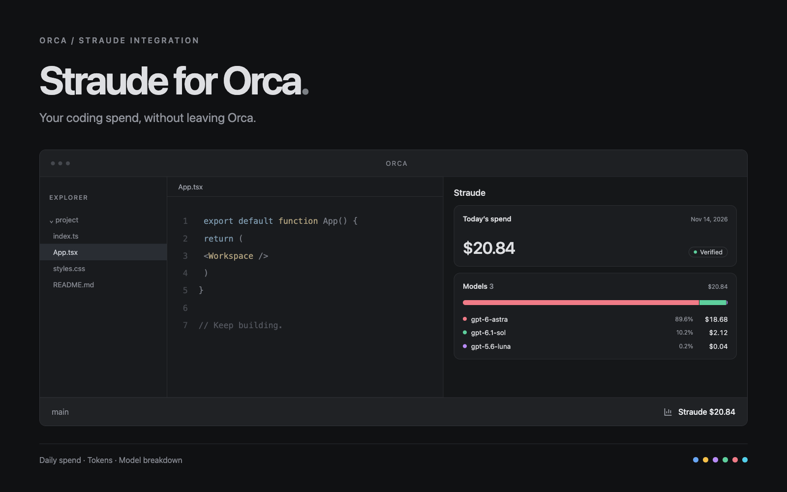

# Straude for Orca

Shows today's published Straude spend in Orca's status bar, with a sidebar panel
for token usage, models, sessions, profile statistics and rankings.

Requires Orca 1.4.248 or newer. No runtime dependencies or build step.

## Preview



The cover is a rendered mockup with sample usage. Its editable source is
[media/mockup.html](media/mockup.html); open it in a browser to preview or export
at 1600 × 1000.

## Install

Install [Orca](https://github.com/stablyai/orca/releases) and turn on plugins under
**Settings → Plugins**, then run:

```sh
orca plugin install alexesprit/orca-straude@v0.1.0 --json
```

Review the returned grants and rerun with its `--approve` fingerprint. The plugin
runs a trusted Node worker, reads its own settings and caches data in its own
storage. This installs and enables `alexesprit.straude`.

Set **Straude username** under
Settings → Plugins → Straude for Orca. A leading `@` is optional.
Choose **Refresh interval** there: 5 (default), 15, 30 or 60 minutes.
Changes apply immediately to the polling schedule and cache lifetime.
Expand **Recent posts** to browse five published posts at a time. Select a date
to see its spend, tokens, sessions and model costs. **Load more** appends older
posts, and **Back to today** returns to current usage. The status bar shows today’s spend.
The panel's **Open Straude** link opens Straude in your default browser.

```sh
orca plugin open alexesprit.straude --panel straude --json
```

## Install locally

From a clone or download of [this repository](https://github.com/alexesprit/orca-straude), run:

```sh
orca plugin install . --json
```

Follow the same fingerprint approval flow. Local installs use `local.straude`.
A local installation copies this repository. Reinstall after source changes.
If you have installed development dependencies, use `npm run install:local`
instead. It copies plugin files into `.orca/install`, excluding `node_modules`
and other development files that Orca's folder installer cannot accept.
If approval is required, rerun the exact command Orca prints, or pass its
fingerprint with `npm run install:local -- --approve <fingerprint>`.

The commands in this README use `orca`, the macOS/Windows CLI name. On Linux,
use `orca-ide`.

## Manage the plugin

For folder installs, replace `alexesprit.straude` with `local.straude`:

```sh
orca plugin list --json
orca plugin logs alexesprit.straude --json
orca plugin shot alexesprit.straude --panel straude --json
orca plugin shot alexesprit.straude --status-bar --json
orca plugin disable alexesprit.straude --json
orca plugin enable alexesprit.straude --json
orca plugin uninstall alexesprit.straude --json
```

Screenshot commands need Orca running with a workspace open. Worker failures go
to the plugin log; failed Straude requests appear as a warning in the panel.

## Data and refresh

The worker uses Straude's public profile and user-feed endpoints without a token.
It refreshes the profile and latest usage at the configured interval; **Refresh** bypasses
the cache. This displays usage published to Straude, rather than tracking Orca
sessions or uploading anything.

Successful responses are cached across restarts. Failed requests show a warning
and cached data. If only the profile request fails, its cached ID lets usage
refresh continue. Yesterday's usage is shown as zero for today, using the local
calendar date, including when offline. Cached data is never reused for a different
username. Network requests time out after ten seconds each.

Straude controls endpoint availability and how up to date its data is. There is
no guarantee these public endpoints will remain unchanged.

The HTML/CSS sidebar shows a segmented model-spend gauge with the Balanced
palette. Models sort by spend; shares use unrounded reported model costs.
Color assignments are saved in the plugin's own storage, and arbitrary model
names are supported. Up to six models get distinct colors; larger sets reuse
colors, with names, percentages and prices still visible. Missing costs display
as unavailable instead of zero. Zero spend has no gauge.

## Develop

With Node.js/npm and the Orca CLI installed, run:

```sh
npm ci
npm run lint       # Biome formatting, linting and import checks
npm run lint:fix   # Apply Biome's safe fixes and formatting
npm test          # Run the plugin tests
npm run validate  # Validate the plugin manifest and assets
npm run check     # Run Orca's plugin checks
npm run install:local # Stage plugin files and install locally, excluding dependencies
npm run ci        # Lint, tests and plugin checks
```

Lefthook installs via `postinstall`: pre-commit runs lint, and pre-push runs CI.
The npm scripts use the `orca` executable; on Linux, use the direct commands below
with `orca-ide`.

The underlying Orca checks are:

```sh
orca plugin test . --json
orca plugin check . --json
orca plugin validate . --json
orca plugin inspect . --json
```

Tests cover caching, refresh, offline fallback, username changes, midnight,
response normalization, model shares, stable color assignments, HTML escaping,
and unconfigured, populated, loading and offline panel output. `plugin check`
validates the manifest; HTML panels need live verification in Orca.

For an optional TypeScript check, generate the host's current typings and run
the compiler (requires Node.js/npm):

```sh
orca plugin types . --json
npx --package typescript tsc -p .
```

## License

MIT. See [LICENSE.md](LICENSE.md).
